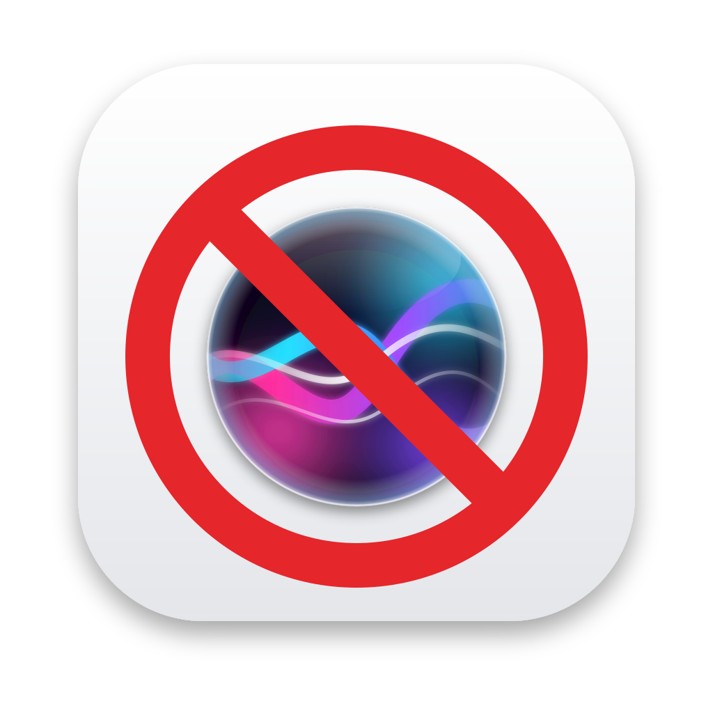

# macos-ai-purge



A Home Manager module that turns off Apple Intelligence and related privacy-relevant data sharing on macOS 26 (Tahoe) and macOS 27. It is a declarative port of the Apple Intelligence and privacy parts of [RemoveMacAI](https://github.com/omlahore/RemoveMacAI) 1.2.0-beta.1.

## Source

The feature catalog, profile layout, model download block and privacy items are all taken from [omlahore/RemoveMacAI](https://github.com/omlahore/RemoveMacAI). When RemoveMacAI adds keys, sync them into `modules/catalog.nix`.

## What It Does

- **Configuration profile.** It generates `~/Library/Application Support/macos-ai-purge/macos-ai-purge.mobileconfig`, which contains:
  - Apple Intelligence restrictions (`com.apple.applicationaccess`),
  - forced managed preferences,
  - a model download block that points `DownloadServerBaseURLOverride-<assetType>` at a closed local port,
  - the locked (profile-only) privacy items.
- **User defaults.** It writes the two non-locked privacy items (`network-ds-store-files`, `icloud-default-save`) and the user-level opt-out `com.apple.CloudSubscriptionFeatures.optIn auto_opt_in = false` via `targets.darwin.defaults`.
- **Activation checks.** On activation it:
  - warns if `macosVersion` doesn't match `sw_vers`,
  - opens the profile for approval if it isn't installed or is outdated (checked through a hash marker in `/Library/Managed Preferences`).

## Usage

Add the flake input and import the module:

```nix
# flake inputs
macos-ai-purge.url = "github:<you>/macos-ai-purge";

# home-manager configuration
imports = [ inputs.macos-ai-purge.homeModules.default ];
programs.macosAiPurge.enable = true;
```

### Complete Option Reference

```nix
programs.macosAiPurge = {
  enable = false; # turn the whole module on
  macosVersion = 26; # major macOS version of the host: 26 | 27; set to 27 after upgrading

  # Every option below names a macOS feature or behaviour: true = enabled, false = turned off.

  # Apple Intelligence features.
  aiFeatures = {
    siri = false; # Siri and its Apple Intelligence integration
    chatgpt = false; # ChatGPT and other external intelligence extensions, incl. sign-in
    writing-tools = false; # Writing Tools: rewrite, proofread, summarize text
    genmoji = false; # generated custom emoji
    image-playground = false; # Image Playground image generation
    mail = false; # Mail message summaries and smart replies
    notification-summaries = false; # summarized notification previews
    messages-summaries = false; # Messages conversation summaries
    safari-summaries = false; # Safari web page summaries
    notes-summaries = false; # Notes audio transcription summaries
    inline-predictions = false; # inline predictive text while typing
    spatial-photos = false; # 3D spatial scenes from 2D photos (macOS 26+)
    photos-clean-up = false; # Photos Clean Up object removal; no switch, only its models are blocked
    xcode-completion = false; # Xcode predictive code completion; no switch, only its models are blocked
  };

  # Privacy mode (RemoveMacAI's presets): "apple" (= null, Apple's defaults) | "recommended" | "privacy".
  # It only sets the defaults of `privacySettings` below; see "Mode Defaults".
  mode = "recommended";

  # Privacy-relevant macOS behaviours. Values shown are the defaults with mode = "recommended";
  # "privacy: …" is the default with mode = "privacy".
  # An explicit value always overrides the mode. (locked) = set via the profile.
  privacySettings = {
    analytics = false; # sending diagnostics and usage data to Apple (locked); privacy: false
    personalized-ads = false; # personalized ads from Apple (locked); privacy: false
    siri-data-sharing = false; # sharing Siri and Dictation audio with Apple (locked); privacy: false
    search-data-sharing = false; # sharing search queries with Apple (locked); privacy: false
    spotlight-web-results = false; # internet results in Spotlight (locked); privacy: false
    lookup-suggestions = false; # online suggestions in Look Up (locked); privacy: false
    safari-suggestions = true; # search engine and Safari suggestions (locked); privacy: false
    game-center = true; # Game Center (locked); privacy: false
    network-ds-store-files = false; # writing .DS_Store files on network volumes; privacy: false
    icloud-default-save = true; # saving new documents to iCloud by default; privacy: true
  };

  # Point AI model downloads at a closed local port: true/false for all sets, or one bool per set:
  # { foundation = true; # base language models (Siri, Writing Tools, summaries, …)
  #   visual = true;     # image models (Genmoji, Image Playground)
  #   spatial = true;    # Spatial Photos models
  #   cleanup = true;    # Photos Clean Up models
  #   code = true; }     # Xcode code completion models
  blockModelDownloads = true;

  profile = {
    identifier = "com.afwlehmann.macos-ai-purge";
    autoOpen = true; # open profile + Device Management when it's missing or outdated
  };
};
```

### Mode Defaults

Default value of each `privacySettings.*` option per `mode`. `true` = the macOS behaviour stays on, `false` = it is turned off.

| `privacySettings.*` | `mode = "apple"` or `null` | `mode = "recommended"` (default) | `mode = "privacy"` |
|:---|:---|:---|:---|
| `analytics` | `true` | `false` | `false` |
| `personalized-ads` | `true` | `false` | `false` |
| `siri-data-sharing` | `true` | `false` | `false` |
| `search-data-sharing` | `true` | `false` | `false` |
| `spotlight-web-results` | `true` | `false` | `false` |
| `lookup-suggestions` | `true` | `false` | `false` |
| `network-ds-store-files` | `true` | `false` | `false` |
| `safari-suggestions` | `true` | `true` | **`false`** |
| `game-center` | `true` | `true` | **`false`** |
| `icloud-default-save` | `true` | `true` | `true` |

`"privacy"` differs from `"recommended"` only in the two bold rows. No mode turns off `icloud-default-save`; set it to `false` explicitly if you want that.

### Precedence

Options are resolved in this order. A later step can't override an earlier one.

1. **`macosVersion`** filters the catalog first. AI features and privacy items newer than the configured version don't exist; for example, `spatial-photos` needs 26.
2. **`aiFeatures`** controls the Apple Intelligence features, and only those. Every available feature is turned off unless `aiFeatures.<id> = true`. `mode` and `privacySettings` never touch these features.
3. **`privacySettings` over `mode`**: `mode` only sets the default of each `privacySettings.<id>` (`false` if the mode covers it, otherwise `true`). An explicit `privacySettings.<id> = true` or `false` always overrides the mode. `"privacy"` covers everything in `"recommended"`, and `mode = "apple"` (or `null`) keeps Apple's defaults, so every item defaults to `true`.
4. **`blockModelDownloads`** can only narrow what `aiFeatures` allows. A model set is blocked only if every feature that uses it is turned off and blocking isn't disabled for that set. Setting it to `true` never blocks a set that an enabled feature needs.
5. **Your own `targets.darwin.defaults`** override this module's user defaults, because the module sets them with `mkDefault`. They have no effect on keys forced by the profile.

On `home-manager switch`, activation detects a missing or outdated profile and opens it together with **System Settings → General → Device Management**, where you approve it. macOS doesn't allow approving a profile without user interaction, so that click stays manual. Set `profile.autoOpen = false` to get only a warning with the `open` command instead.

## Upgrading to macOS 27

1. Set `macosVersion = 27`.
2. Run `home-manager switch`; the regenerated profile opens automatically.
3. Approve it in System Settings.

Version-specific entries live in `modules/catalog.nix` (`since = <major>`). RemoveMacAI's code has no per-version branches between 26 and 27, so today the two profiles differ only in the version marker. To add keys that only exist on 27, add catalog entries with `since = 27`.

## Conflicting Settings

Nix evaluation **never** reports these conflicts. Nix-darwin and this module live in separate module systems, and both write to the same macOS preferences. Set each key in exactly one place.

The tables were checked against nix-darwin `ff0e21a` (2026-10-31): `modules/system/defaults/*.nix` and `modules/system/defaults-write.nix`.

### Which Value Wins

- **Home Manager as a nix-darwin module** (`home-manager.users.*`): `darwin-rebuild` runs nix-darwin's `userDefaults` first and Home Manager in `postActivation` afterwards (`modules/system/activation-scripts.nix`). This module's value wins.
- **Standalone Home Manager:** whichever of `darwin-rebuild switch` and `home-manager switch` ran last wins, so the value flips back and forth.
- **Configuration profile (forced preferences):** these always win over user defaults written by nix-darwin, Home Manager or `defaults write`, for as long as the profile is installed.
- **Your own Home Manager `targets.darwin.defaults`:** this module only uses `mkDefault`, so your value wins at evaluation time and nothing conflicts.

### Same Key Written by Both (Privacy Items, User Defaults)

| Privacy item (when `false`) | Domain / key written here (value) | Conflicting nix-darwin option |
|---|---|---|
| `icloud-default-save` | `NSGlobalDomain` `NSDocumentSaveNewDocumentsToCloud` (`false`) | `system.defaults.NSGlobalDomain.NSDocumentSaveNewDocumentsToCloud` |

Two writes from this module have no dedicated nix-darwin option. They conflict only if `system.defaults.CustomUserPreferences` sets the same keys:
- `network-ds-store-files = false`: `com.apple.desktopservices` `DSDontWriteNetworkStores` (`true`)
- always written when the module is enabled: `com.apple.CloudSubscriptionFeatures.optIn` `auto_opt_in` (`false`)

### Profile-Forced Key That nix-darwin Can Also Set

| AI feature (when `false`) | Forced in profile (value) | nix-darwin option that becomes ineffective |
|---|---|---|
| `inline-predictions` | `.GlobalPreferences` `NSAutomaticInlinePredictionEnabled` (`false`) | `system.defaults.NSGlobalDomain.NSAutomaticInlinePredictionEnabled` |

All other profile keys (`com.apple.applicationaccess` restrictions, `com.apple.assistant.support`, `com.apple.Siri`, `group.com.apple.mail`, `group.com.apple.usernoted`, `com.apple.MobileSMS`, `com.apple.lookup.shared`, `com.apple.Safari`, `com.apple.spatialphotosrelive`, `com.apple.MobileAsset`) have no dedicated nix-darwin option. Values for them set via `CustomUserPreferences` or `CustomSystemPreferences` are overridden while the profile is installed. Nix-darwin has no module for configuration profiles, so the profile itself can't collide.

## Out of Scope

- **RemoveMacAI's general macOS tweaks.** Finder, Dock, typing and window tweaks (e.g. `click-to-desktop`, `path-bar`, `dock-recents`), the service restrictions `iphone-mirroring`, `music-classic` and `book-store`, and the imperative ones (`media-keys`, `music-launches`, `dock-apple-apps`, `show-library`, background items). They aren't related to AI or privacy; set them with `targets.darwin.defaults` or nix-darwin's `system.defaults`.
- **Deleting models already on disk.** RemoveMacAI does this through a private XPC call (`ResetAssetSets`). The download block only prevents re-downloads.
- **Undo.** `targets.darwin.defaults` never deletes keys, so switching a user-default privacy item back to `true` leaves the last written value in place. Removing the profile in System Settings undoes everything the profile set.
